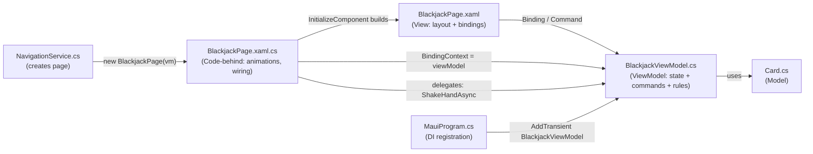

# File Structure: XAML, Code-Behind, and C# Classes

This project uses the MVVM pattern (Model-View-ViewModel). The Blackjack feature is the example used below.

---

## The Three File Types

| File | Role | Layer |
|---|---|---|
| `.xaml` | Declares the UI: layout, controls, styles, and bindings | View |
| `.xaml.cs` | Code-behind: wiring the View to the ViewModel and handling UI-only work (animations, platform/UI APIs) | View |
| `.cs` | Plain C# class: state, logic, and commands | ViewModel or Model |

---

## 1. `.xaml` (the View)

`BlackjackPage.xaml` describes what the screen looks like. It is compiled into C# at build time.

Key parts in this project:

- **Root element and class link:** `<ContentPage x:Class="PartyGames.Features.Blackjack.BlackjackPage">` tells the compiler that this XAML belongs to the `BlackjackPage` class. `x:Class` must match the code-behind class.
- **Resources:** `CardTemplate` is a `DataTemplate` reused for every card, so the card layout is defined once.
- **Bindings:** `Text="{Binding Money, StringFormat='Money: {0}'}"` reads the `Money` property from the page's `BindingContext`. When `Money` changes and raises `PropertyChanged`, the label updates.
- **Commands:** `Command="{Binding DealCommand}"` connects a button tap to a command on the ViewModel. No click handler is needed in code-behind.
- **Named elements:** `x:Name="DealerRow"` creates a C# field with that name in the generated partial class, so code-behind can reference it (used for the shake animation).
- **Visibility:** `IsVisible="{Binding IsBetting}"` shows or hides controls based on ViewModel state.

The XAML contains no game logic. It only describes layout and binds to data.

---

## 2. `.xaml.cs` (Code-Behind)

`BlackjackPage.xaml.cs` is the partial class half that pairs with the XAML.

```csharp
public partial class BlackjackPage : ContentPage
```

The `partial` keyword lets the compiler merge this file with the generated code from `BlackjackPage.xaml`. The generated half calls `InitializeComponent()`, which builds the visual tree and creates the `x:Name` fields.

Responsibilities in this project:

1. **Receive the ViewModel** through the constructor, which is injected by dependency injection:
   ```csharp
   public BlackjackPage(BlackjackViewModel viewModel)
   {
       InitializeComponent();
       BindingContext = viewModel;
   ```
2. **Give the ViewModel access to UI-only behavior.** The ViewModel cannot reference `DealerRow` directly, so the page passes in delegates:
   ```csharp
   viewModel.ShakeHandAsync = dealer => ShakeAsync(dealer ? DealerRow : PlayerRow);
   viewModel.ShowMoneyChangeAsync = ShowMoneyChangeAsync;
   ```
3. **Run animations.** `ShakeAsync` and `ShowMoneyChangeAsync` use `TranslateToAsync` and `FadeToAsync`. These are visual effects on controls, so they belong in the View, not the ViewModel.

Rule of thumb: code-behind should contain UI-only code. Business logic goes in the ViewModel.

---

## 3. `.cs` (ViewModel or Model)

`BlackjackViewModel.cs` is a plain C# class with no UI types. It inherits `BaseViewModel`, which provides `SetProperty` and `OnPropertyChanged` for change notification.

Contents:

- **State:** properties such as `Money`, `Bet`, `IsRoundActive`, and `StatusMessage`. Each setter calls `SetProperty`, which raises `PropertyChanged` so the UI updates.
- **Commands:** `DealCommand`, `HitCommand`, `StandCommand`. Each is a `Command` with an `execute` action and a `canExecute` check. The button is disabled automatically when `canExecute` returns false.
- **Game rules:** `HandValue`, `Settle`, the dealer's draw rule (stand on 17), and the betting limits.
- **Testable logic:** because it has no UI dependency, it can be unit tested without running the app.

`Card.cs` is a Model. It holds data about one card (rank, suit, face-down state) and has little or no behavior. The ViewModel uses it, and the XAML displays it through `CardTemplate`.

---

## How the Pieces Connect



---

## Startup and Navigation Flow

1. **`MauiProgram.cs`** registers services and ViewModels with dependency injection: `builder.Services.AddTransient<BlackjackViewModel>();`
2. **`AppShell.xaml` / `AppShell.xaml.cs`** register the `blackjack` route: `Routing.RegisterRoute("blackjack", typeof(BlackjackPage));`
3. **`NavigationService.cs`** creates the page and resolves its ViewModel from DI: `"blackjack" => new BlackjackPage(_serviceProvider.GetRequiredService<BlackjackViewModel>())`
4. The page's constructor runs `InitializeComponent()` (from the `.xaml`), sets `BindingContext` to the ViewModel, and the screen appears.
5. User taps trigger ViewModel commands. The ViewModel changes its properties. The bindings in the `.xaml` update the screen.

---

## Interview Summary

- **XAML** describes the UI and binds to data. It is declarative and has no logic.
- **XAML code-behind (`.xaml.cs`)** is the other half of the same partial class. It handles view-only work such as animations and passing UI delegates to the ViewModel.
- **C# class (`.cs`)** holds the state, rules, and commands. It is UI-independent and testable.
- **Data flow:** ViewModel properties raise change notifications, bindings update the View, and user input in the View calls ViewModel commands.
- **Why MVVM:** it separates what the app does (ViewModel) from how it looks (View), which makes logic easier to test and UI easier to change.
