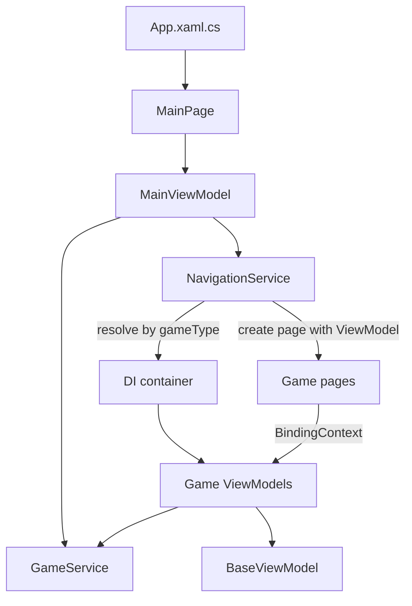
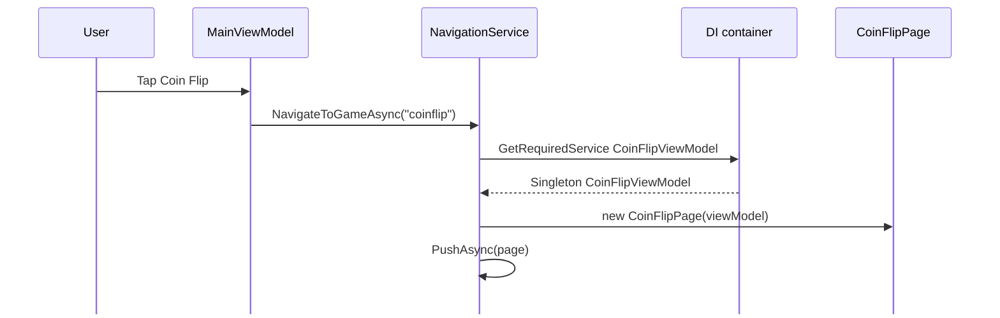

# Party Games

A cross-platform party game app built with .NET MAUI for Android and Windows.

## Games

- **Dice Roller:** Choose d4, d6, d8, d10, d12 or d20 and roll up to 8 dice at once. Roll history keeps the last 30 rolls.
- **Coin Flip:** Flip a coin.
- **Tic-Tac-Toe:** Play against a friend or the CPU (Easy, Medium or Hard). Pick X or O for the CPU mode; X always goes first. Scores are tracked for X and O.
- **Higher or Lower:** Two players share one shuffled 52-card deck (Ace high). Player 1 starts. Guess whether the next card is higher or lower than the card on the discard pile. A correct guess scores for the guessing player; a wrong guess scores for the other player. The game ends when the stack is empty.
- **Higher or Lower +:** A drinking version of Higher or Lower. The card difference is the number of sips.
- **Blackjack:** Play against the dealer with a 500 chip bankroll. Bets move in steps of 5. Hit, stand, double down and split are available, and a natural pays 3:2.

## Implementation

### Architecture



- MVVM. Each game has a ViewModel in `Features/<Game>/` and a XAML page with code-behind. ViewModels derive from `BaseViewModel`, which implements `INotifyPropertyChanged` and provides `SetProperty`, `IsBusy` and `Title`.
- Pages bind to ViewModels and send input through commands. ViewModels reach back into the view for animations through `Func` delegates set by the page code-behind, such as `DrawAnimationAsync` in Higher or Lower and `ShakeHandAsync` in Blackjack. Game rules do not reference UI types.
- Dependency injection (DI) uses the built-in container set up in `MauiProgram.cs`. Classes declare what they need in their constructor, and the container supplies it, so no class creates its own services. A singleton registration is one shared instance for the whole app. A transient registration creates a new instance on each request.
- `IGameService`, `INavigationService` and `MainViewModel` are singletons. `DiceGameViewModel` and `CoinFlipViewModel` are also singletons, so their history survives leaving the page. `BlackjackViewModel`, `TicTacToeViewModel` and `HigherLowerViewModel` are transient, so each visit starts fresh.
- Pages are not registered in the container. `NavigationService` creates each page with `new` and passes in the ViewModel the container resolved.
- `NavigationService` maps a game key (for example `"tictactoe"`) to its page. It resolves the ViewModel from the service provider, creates the page with that ViewModel, and pushes it onto the navigation stack. It also writes diagnostic lines to `partygames_debug.log` in the app data directory.
- `GameService` provides the shared randomness (`RollDice`, `FlipCoin`) and the game catalog for the main menu (`GetAllGames`).

### Navigation

This example follows Coin Flip. Every game uses the same path, and only the game key, ViewModel and page differ.



### Dice Roller

- `DiceGameViewModel` clamps the dice count to 1 through 8. Changing the count or the die type rebuilds the dice list with zero values.
- Rolling sets `IsBusy`, waits 500 ms for the roll animation, then sums the values.
- The best roll and roll history are kept for the current die type only. Switching die type clears both.
- History is newest first and capped at 30 entries.

### Coin Flip

- `FlipAsync` gets the result from `GameService.FlipCoin()` before animating, so the outcome does not depend on the animation.
- The animation runs 12 frames at 80 ms, alternating between the sword and skull images and stepping the rotation by 90 degrees.
- The final face is shown after the last frame. Results are added to a history capped at 30 entries. `ClearHistory()` empties it.
- The `IsFlipping` guard ignores taps while a flip is in progress.

### Tic-Tac-Toe

- The board is a `char[9]` checked against the eight winning lines. Each cell is a `TicTacToeCell` bound to the view.
- Two-player mode alternates X and O. CPU mode lets the player pick their mark and difficulty.
- CPU difficulty:
  - Easy: random empty cell.
  - Medium: random or best move, chosen with equal probability each turn.
  - Hard: best move from minimax. Scores are weighted by depth, so faster wins and slower losses score higher.
- The CPU waits 500 ms before moving. Each round has an ID, and the CPU turn checks it after the delay, so a move from a previous round is discarded.
- Win and draw counts are kept for the current mode and reset when a mode starts.

### Higher or Lower

- `HigherLowerViewModel` builds a 52-card deck and shuffles it with Fisher-Yates. Cards are drawn from the end of the list.
- Ace is 14 for comparison. Equal ranks count as wrong guesses for Higher and Lower. Straight is a correct guess only when the next card has the same rank.
- A guess moves the showcase card to the discard pile, draws the next card, and compares the two. A correct guess scores for the guessing player, otherwise the other player scores. The turn then passes.
- The view sets `DrawAnimationAsync` and `DiscardAnimationAsync` delegates. The ViewModel awaits them, so game logic does not depend on the UI.
- When the deck is empty, the game ends and shows the winner or a draw.

#### Higher or Lower +

- `HigherLowerPlusViewModel` inherits `HigherLowerViewModel` and overrides `Judge`, so the same page and deck logic are reused.
- The card difference is the number of sips. A correct guess makes the other player drink. A wrong guess makes the guesser drink.
- An Ace always counts against the guesser. For Higher, a showcase Ace is 14 and a drawn Ace is 1. For Lower, a showcase Ace is 1 and a drawn Ace is 14.
- A tie or two Aces costs the guesser 1 sip.
- Straight: a correct Straight gives 2 sips. A wrong Straight costs the difference. With one Ace, the Ace value closer to the other card is used.
- `BeginCommand`, `HigherCommand`, `StraightCommand`, `LowerCommand` and `PlayAgainCommand` are enabled through `CanBegin`, `CanGuess` and `IsGameOver`. Input is blocked while an animation runs.
- Messages use a `>>` prompt format, for example `>> Player 1 = // CORRECT //`, `>> Player 2 = TAKE 7 SIPS` and `>> Player 2 = HIGHER OR LOWER?`. The start prompt and the game-over line also start with `>>`.
- The sip count in each message is shown in bold orange. Messages are left-aligned in a fixed-height status area at the top of the screen.
- The Plus screen uses a monospace font for the title, scores, status text and buttons. Base Higher or Lower keeps the default font and centered status text.
- The Plus buttons use the dark green title background with yellow borders and text. The Plus overrides are `FontFamilyName`, `StatusAlignment`, the button fill, border and text colors, and `PlayAgainBorder`. The base ViewModel returns the original values, so the shared page does not need variant-specific code.

### Blackjack

- `BlackjackViewModel` is transient, so each visit starts with 500 chips. When the bankroll drops below the minimum bet (5), Reset restores it.
- The bet starts at 5 and changes in steps of 5, capped at the current bankroll. Changing the bet is only allowed between rounds. Deal is enabled only when the bet is affordable.
- Each deal builds and shuffles a fresh 52-card deck. The player gets two cards. The dealer gets one face-up card and one face-down hole card. The hole card stays hidden until the player stands or the round ends.
- Hand value counts aces as 11 unless that would bust. Five or more cards that do not bust count as 21 (Charlie rule). A natural is only two cards totaling 21.
- Actions:
  - Hit draws one card. Busting or reaching five cards ends the hand.
  - Stand ends the hand.
  - Double down doubles the stake, draws exactly one card, and ends the hand. It requires two cards and enough unallocated money.
  - Split turns a pair into two hands, each with a stake equal to the original bet, and draws one card into each. Ranks do not need to match: any two cards with the same base value can split, so J, Q, K and 10 all count as 10. Up to four hands are allowed, and each new hand can be split again. Split aces receive one card each and then stand.
- Animations: each drawn card is shown for 400 ms. The dealer draws while below 17 (soft 17 stands). The round settles 800 ms after the last card.
- When every player hand busts, the dealer does not play and the round settles immediately after 800 ms.
- Settlement, per hand:
  - A bust is a dealer win and loses the stake.
  - A natural beats any non-natural 21, and it only counts on an unsplit opening hand. It pays 3:2 (integer division of the stake).
  - A dealer natural beats any non-natural player hand.
  - A natural against a dealer natural is a push.
  - A dealer bust or a higher total wins 1:1.
  - A tie on total is a push and returns the stake.
  - A lower total loses the stake.
- The bankroll changes by the net of all hands. A hand's stake is the amount at risk for that hand. The result popup appears in the controls area below the table, so the cards stay in place. The result message lists each hand when there is a split.
- `Card` derives from `BaseViewModel` so flipping `IsFaceDown` updates the view, and the page shakes the hand row through `ShakeHandAsync`.

## Requirements

- .NET 10 SDK
- .NET MAUI workload
- Android SDK for Android builds
- JDK 21 (JDK 25 is not supported)

## Build and Run

Android:

```
dotnet build -t:Run -f net10.0-android -c Debug -p:JavaSdkDirectory="<path-to-jdk-21>"
```

Windows:

```
dotnet build PartyGames.csproj -f net10.0-windows10.0.19041.0 -c Debug
```

## Project Structure

```
/
  App.xaml.cs    Creates the window and the root NavigationPage
  MauiProgram.cs Dependency injection setup
  Features/      One folder per screen or game, with its page, ViewModel and game types
    Main/
    DiceRoller/
    CoinFlip/
    TicTacToe/
    HigherLower/
    Blackjack/
  ViewModels/    BaseViewModel
  Services/      GameService, NavigationService
  Models/        Game
  Converters/    XAML value converters
  Resources/     Styles, colors, images, fonts
  Platforms/     Android, Windows, iOS and Mac Catalyst entry points
```
