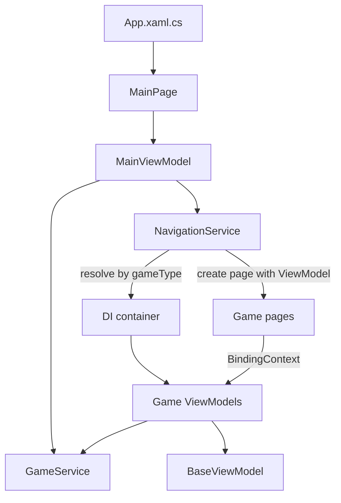
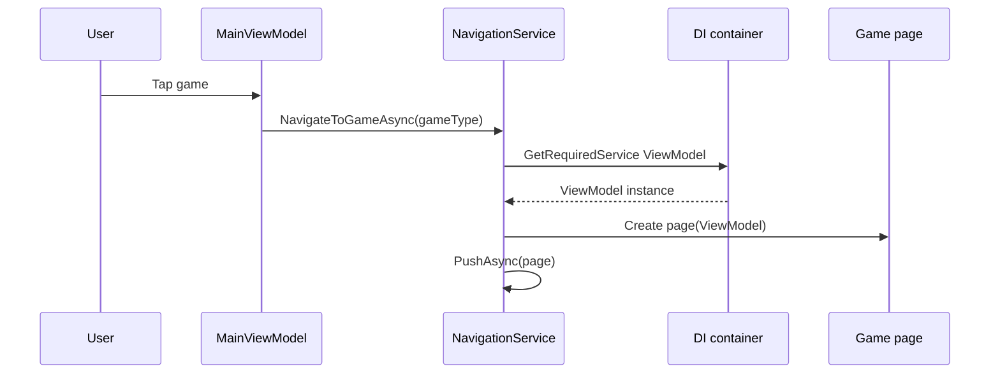

# Party Games

A cross-platform party game app built with .NET MAUI for Android and Windows.

## Games

- **Dice Roller:** Choose d4, d6, d8, d10, d12 or d20 and roll up to 8 dice at once. Roll history keeps the last 30 rolls.
- **Coin Flip:** Flip a coin.
- **Tic-Tac-Toe:** Play against a friend or the CPU (Easy, Medium or Hard). Pick X or O for the CPU mode; X always goes first. Scores are tracked for X and O.
- **Higher or Lower:** Two players share one shuffled 52-card deck (Ace high). Player 1 starts. Guess whether the next card is higher or lower than the card on the discard pile. A correct guess scores for the guessing player; a wrong guess scores for the other player. The game ends when the stack is empty.
- **Blackjack:** Play against the dealer with a 500 chip bankroll. Bets move in steps of 5.

## Implementation

### Architecture



- MVVM. Each game has a ViewModel in `Features/<Game>/` and a XAML page with code-behind. ViewModels derive from `BaseViewModel`, which implements `INotifyPropertyChanged` and provides `SetProperty`, `IsBusy` and `Title`.
- Pages bind to ViewModels and send input through commands. ViewModels reach back into the view for animations through `Func` delegates set by the page code-behind, such as `DrawAnimationAsync` in Higher or Lower and `ShakeHandAsync` in Blackjack. Game rules do not reference UI types.
- Dependency injection is configured in `MauiProgram.cs`. `IGameService` and `INavigationService` are singletons. `DiceGameViewModel` and `CoinFlipViewModel` are singletons, so their history survives leaving the page. `BlackjackViewModel`, `TicTacToeViewModel` and `HigherLowerViewModel` are transient, so each visit starts fresh.
- `NavigationService` maps a game key (for example `"tictactoe"`) to its page. It resolves the ViewModel from the service provider, creates the page with that ViewModel, and pushes it onto the navigation stack. It also writes diagnostic lines to `partygames_debug.log` in the app data directory.
- `GameService` provides the shared randomness (`RollDice`, `FlipCoin`) and the game catalog for the main menu (`GetAllGames`).

### Navigation



### Dice Roller

- `DiceGameViewModel` clamps the dice count to 1 through 8. Changing the count or the die type rebuilds the dice list with zero values.
- Rolling sets `IsBusy`, waits 500 ms for the roll animation, then sums the values.
- The best roll and roll history are kept for the current die type only. Switching die type clears both.
- History is newest first and capped at 30 entries.

### Coin Flip

- `FlipAsync` gets the result from `GameService.FlipCoin()` before animating, so the outcome does not depend on the animation.
- The animation runs 12 frames at 80 ms, alternating between the sword and skull images and stepping the rotation by 90 degrees.
- The final face is shown after the last frame. Results are added to a history capped at 30 entries. `ClearHistory()` empties it.
- The `IsFlipping` guard ignores taps while a flip is in progress.

### Tic-Tac-Toe

- The board is a `char[9]` checked against the eight winning lines. Each cell is a `TicTacToeCell` bound to the view.
- Two-player mode alternates X and O. CPU mode lets the player pick their mark and difficulty.
- CPU difficulty:
  - Easy: random empty cell.
  - Medium: random or best move, chosen with equal probability each turn.
  - Hard: best move from minimax. Scores are weighted by depth, so faster wins and slower losses score higher.
- The CPU waits 500 ms before moving. Each round has an ID, and the CPU turn checks it after the delay, so a move from a previous round is discarded.
- Win and draw counts are kept for the current mode and reset when a mode starts.

### Higher or Lower

- `HigherLowerViewModel` builds a 52-card deck and shuffles it with Fisher-Yates. Cards are drawn from the end of the list.
- Ace is 14 for comparison. Equal ranks count as wrong guesses for both Higher and Lower.
- A guess moves the showcase card to the discard pile, draws the next card, and compares the two. A correct guess scores for the guessing player, otherwise the other player scores. The turn then passes.
- The view sets `DrawAnimationAsync` and `DiscardAnimationAsync` delegates. The ViewModel awaits them, so game logic does not depend on the UI.
- When the deck is empty, the game ends and shows the winner or a draw.
- `BeginCommand`, `HigherCommand`, `LowerCommand` and `PlayAgainCommand` are enabled through `CanBegin`, `CanGuess` and `IsGameOver`. Input is blocked while an animation runs.

### Blackjack

- `BlackjackViewModel` is transient, so each visit starts with 500 chips. When the bankroll drops below the minimum bet (5), Reset restores it.
- The bet starts at 5 and changes in steps of 5, capped at the current bankroll. Deal is only enabled between rounds.
- Each deal builds and shuffles a fresh 52-card deck. The player gets two cards. The dealer gets one face-up card and one face-down hole card, and the dealer total stays hidden until the hole card is revealed.
- Hit draws one card for the player. Going over 21 settles the round after 800 ms.
- Stand reveals the hole card. The dealer draws while the total is below 17 (soft 17 stands), 400 ms per card, then the round settles after 800 ms.
- Hand value counts aces as 11 unless that would bust. A two-card 21 is not paid differently from any other 21.
- Settlement: a player bust is a dealer win. A dealer bust or a higher player total is a player win. A lower player total is a dealer win. A tie is a dealer advantage, which costs the player the bet.
- The bankroll changes by plus or minus the bet. `Card` derives from `BaseViewModel` so flipping `IsFaceDown` updates the view, and the page shakes the hand row through `ShakeHandAsync`.

## Requirements

- .NET 10 SDK
- .NET MAUI workload
- Android SDK for Android builds
- JDK 21 (JDK 25 is not supported)

## Build and Run

Android:

```
dotnet build -t:Run -f net10.0-android -c Debug -p:JavaSdkDirectory="<path-to-jdk-21>"
```

Windows:

```
dotnet build PartyGames.csproj -f net10.0-windows10.0.19041.0 -c Debug
```

## Project Structure

```
/
  App.xaml.cs    Creates the window and the root NavigationPage
  MauiProgram.cs Dependency injection setup
  Features/      One folder per screen or game, with its page, ViewModel and game types
    Main/
    DiceRoller/
    CoinFlip/
    TicTacToe/
    HigherLower/
    Blackjack/
  ViewModels/    BaseViewModel
  Services/      GameService, NavigationService
  Models/        Game
  Converters/    XAML value converters
  Resources/     Styles, colors, images, fonts
  Platforms/     Android, Windows, iOS and Mac Catalyst entry points
```
